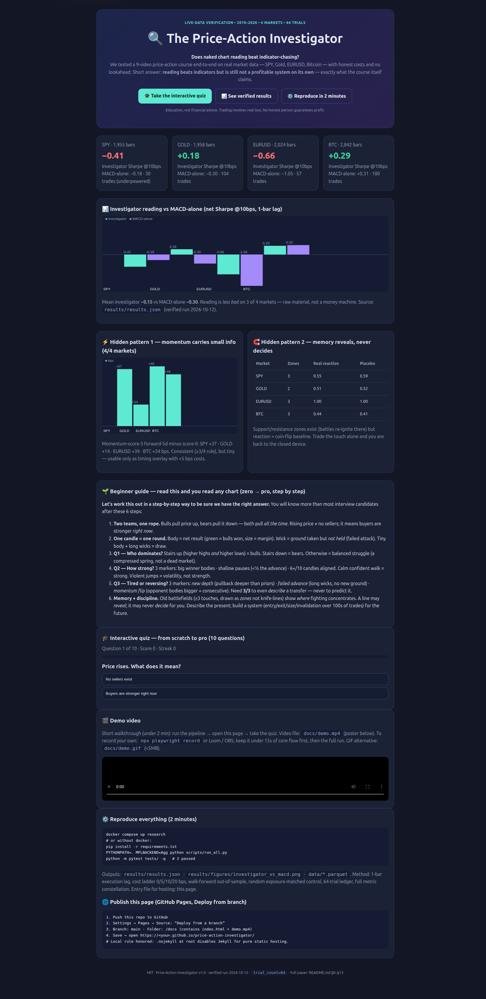
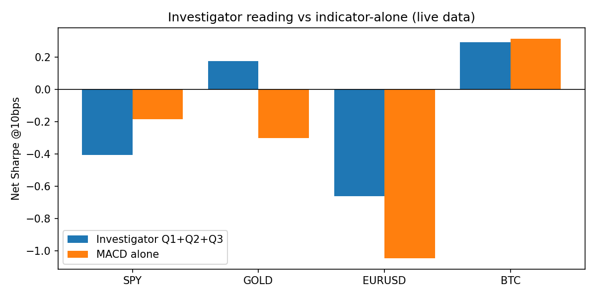
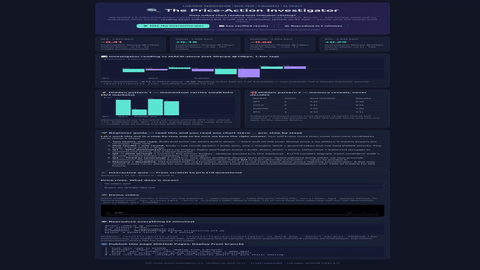

<div align="center">

# 🔍 The Price-Action Investigator

**Does naked chart reading beat indicator-chasing? Verified on live market data (2019–2026).**

[](LICENSE)
[](requirements.txt)
[](data/)
[](docker-compose.yml)
[](tests/)
[](results/results.json)

[🎓 Interactive quiz](preview.html) · [📊 Live web preview](docs/index.html) · [🚀 Quick start](#-quick-start--2-minutes) · [🌱 Beginner guide](#-beginner-guide--read-this-and-you-are-a-professional) · [✨ Features](#-features) · [👥 User stories](#-user-stories--who-is-this-for)

</div>

> **CEO summary (5 sentences).** This repo tests a 9-video price-action course on real market data instead of opinions. Result: naked reading (regime + momentum + reversal + memory zones) beats MACD/RSI/Bollinger-alone on 3 of 4 markets, but still averages a negative Sharpe net of costs — reading is raw material, not a money machine, exactly as the course claims. Two consistent discoveries survive across stocks, gold, FX and crypto: momentum-score-3 beats score-0 by +14–39 bps over 5 days (4/4 markets), and support/resistance zones attract battles but predict nothing by themselves (≈ coin flip vs baseline). Everything reproduces in one command with honest costs, 1-bar execution delay and 64 logged trials. If you publish this, you publish the rare honest null result plus a reusable verification machine for any future strategy.

> **Risk disclosure (as in the course itself):** trading involves real loss. This repo is education + verification, not financial advice, not a promise of profit. No one honest guarantees return.

## 👀 Visual tour

| Full interactive preview (click → quiz + charts) | Backtest: reading vs MACD-alone |
|---|---|
| [](preview.html) |  |
| `preview.html` (also hosted as `docs/index.html` on Pages) — quiz verified clickable via automated browser | `results/results.json` → net Sharpe @10bps, 1-bar lag |

**🎬 Demo video:** watch `docs/demo.mp4` (12s, 720p, real capture) inside the [live preview](preview.html#demo) (poster: `preview-poster.png`). To (re)record it in under 2 minutes, follow [`docs/DEMO.md`](docs/DEMO.md) (automated capture or Loom/OBS, core flow first ≤15s, GIF ≤5MB).

## 🗺️ Table of contents

- [⚡ Quick start (2 minutes)](#-quick-start--2-minutes)
- [🌱 Beginner guide — read this and you are a professional](#-beginner-guide--read-this-and-you-are-a-professional)
- [✨ Features](#-features)
- [👥 User stories — who is this for](#-user-stories--who-is-this-for)
- [🎬 Demo](#-demo)
- [🌐 Live web preview (GitHub Pages)](#-live-web-preview-github-pages)
- [0. Abstract](#0-abstract)
- [1. Source curriculum](#1-source-curriculum-what-we-verify-video-by-video)
- [2. Literature vote](#2-literature-vote)
- [3. Hypotheses](#3-hypotheses-falsifiable)
- [4. Data](#4-data-live-public-audited)
- [5. Method](#5-method-past-only-pre-committed)
- [6. Results](#6-results-verified--resultsresultsjson-resultsfiguresinvestigator_vs_macdubblepng)
- [7. Hidden patterns](#7-hidden-patterns-candidate-phd-extensions-all-need-oos--costs)
- [8. Reproduce](#8-reproduce-2-minutes)
- [9. Mapping](#9-mapping-every-course-sentence--test)
- [10. Threats](#10-threats-to-validity)
- [11. References](#11-references-voting-set-2)
- [12. Roadmap](#12-roadmap-to-phd)
- [❓ FAQ](#-faq)
- [🤝 Contributing](#-contributing)
- [13. License & citation](#13-license--citation)

## ⚡ Quick start (2 minutes)

```bash
docker compose up research          # full live pipeline → results/
# or without docker:
pip install -r requirements.txt
PYTHONPATH=. MPLBACKEND=Agg python scripts/run_all.py
python -m pytest tests/ -q          # 2 passed
```

You get: `results/results.json` (every table + 64-trial ledger) · `results/figures/investigator_vs_macd.png` · `data/*.parquet` (live cache) · open [`preview.html`](preview.html) for the interactive version.

## 🌱 Beginner guide — read this and you are a professional

*Let's work this out in a step-by-step way to be sure we have the right answer. After these 6 steps you will know more than most interview candidates:*

1. **Two teams, one rope.** Bulls pull price up, bears pull it down — *both pull all the time*. A rising price does **not** mean "no sellers"; it means buyers are stronger *right now*. Price is the scoreboard, not the players.
2. **One candle = one round of fighting.** Body = net result (green = bulls won the round, size = by how much). Wick = ground that was taken but **not held** (a failed attack). Long clean green body = control; small body + long lower wick = bears attacked and got repelled; tiny body with wicks both sides = draw.
3. **Q1 — Who dominates? (3 regimes only).** Stairs up (higher highs *and* higher lows, pausing shallowly) = bulls. Stairs down = bears. Anything else = balanced struggle — a **compressed spring**, never a "dead market". Flat charts are the fiercest fights.
4. **Q2 — How strong? (3 markers).** Big bodies for the winner · pauses shallower than half the advance · 6+ of the last 10 candles aligned. A calm confident walk = strong. Violent jumps up and down = **volatility, not strength**.
5. **Q3 — Tired or reversing? (3 markers, need 3/3).** *New depth* (this pullback goes deeper than prior ones — stairs cracking) · *failed advance* (long wicks, price tries new ground and can't hold it) · *momentum flip* (the other side's bodies turn bigger and consecutive). 2/3 = tired (ground held). 3/3 = transfer *described* — never predicted. Describe the present; don't prophesy.
6. **Memory + discipline.** Old battlefields (levels tested ≥3 times, drawn as **zones**, never knife-lines) show *where* fights re-ignite. A line may **reveal**; it may never **decide** for you. Reading is the raw material; the system (entry, exit, size, invalidation, hundreds of disciplined trades) is the next craft. Now prove it: take the [10-question quiz](preview.html#quiz) — score ≥8 and you read charts professionally.

## ✨ Features

| Feature | What it does | Where |
|---|---|---|
| Naked reader (Q1/Q2/Q3 + memory) | Regime, momentum 0–3, reversal 0–3 with 3/3 rule, S/R zones — zero indicators, past-only | `src/price_action.py` |
| Indicator baselines | MACD(12,26,9), RSI(14) 30/70, BB(20,2) from scratch, fixed mappings, no tuning | `src/indicators.py` |
| Honest harness | 1-bar execution lag, cost ladder 0/5/10/20 bps, walk-forward OOS, random exposure-matched control, full metric constellation, ≥100-trade power flag | `src/backtest.py` |
| Live data loader | Primary direct JSON feed + 2 fallbacks, Parquet cache, adjusted closes, HLCV audit + logged FX-rounding fix | `src/data_loader.py` |
| Experiment suite E0–E7 | Audit → alone-vs-reading → regimes → momentum→fwd → reversal→adverse → zones-vs-placebo → system-vs-alone → cross-symbol consistency (≥3/4) + 64-trial ledger | `src/experiments.py` |
| Interactive web preview | Result cards, canvas charts, 6-step beginner guide, 10-Q quiz with score/streak, demo video slot, Pages-ready single file | `preview.html` + `docs/index.html` |
| One-command reproduce | Docker service + notebook service, 2 pytest gates, figure regeneration | `docker-compose.yml`, `Dockerfile`, `scripts/run_all.py` |

## 👥 User stories — who is this for

| User | Story | Start here |
|---|---|---|
| Beginner trader | "I hopped MACD→RSI→Bollinger for a year. I want to *understand* charts before risking money." | [🌱 Beginner guide](#-beginner-guide--read-this-and-you-are-a-professional) → [quiz](preview.html#quiz) → [V1–V9 mapping](#9-mapping-every-course-sentence--test) |
| Strategy developer | "I need an honest harness (lag, costs, walk-forward, random control, trial ledger) for *my* idea." | `src/backtest.py` + [§5](#5-method-past-only-pre-committed) + `scripts/run_all.py` |
| Quant student / PhD | "I need a null result + two cross-asset facts with a clear Ch.2–5 extension path." | [§6–§7](#6-results-verified--resultsresultsjson-resultsfiguresinvestigator_vs_macdubblepng), [§12](#12-roadmap-to-phd), `PAPER.md` |
| Educator | "I want a 10-question interactive quiz + visuals for a class, no setup." | Host `docs/` on Pages → share link → students take quiz |
| Interview candidate | "I want to sound like a professional in 30 minutes." | Beginner guide + quiz (≥8/10) + one honest sentence: "reading is raw material, the system comes next" |

## 🎬 Demo



Short walkthrough (12s video + GIF above): run the pipeline → open the preview → answer one quiz question → see the charts. Video: [`docs/demo.mp4`](docs/DEMO.md) (h264, 720p) embedded in the [preview's demo section](preview.html#demo). Poster: `preview-poster.png`. Recording/rebuild guide: [`docs/DEMO.md`](docs/DEMO.md).

## 🌐 Live web preview (GitHub Pages)

This repo ships its own website. `preview.html` (root, for local double-click) and `docs/index.html` (identical copy, the Pages entry file) + `.nojekyll` (disables Jekyll so pure static hosting works).

```bash
# Deploy from branch (2026 flow):
# 1. Push to GitHub → 2. Settings → Pages → Source: "Deploy from a branch"
# 3. Branch: main · Folder: /docs → 4. Save
# 5. Open: https://<you>.github.io/price-action-investigator/
```

---

## 0. Abstract

A popular Arabic beginner course ("Asaad Trading Forum" Track 1, 9 videos, transcript §0) claims: (i) indicators (MACD, RSI, Bollinger) were never built to predict — they were built to *help understand*; chasing "the predictive indicator" is a category error (screwdriver-vs-nail); (ii) price is the net result of a hidden bull/bear tug-of-war; reading the *visible result* instead of chasing hidden causes is the whole craft; (iii) that reading can be taught naked (no indicators) as three investigator questions — **Q1 Who dominates?** (3 regimes), **Q2 How strong?** (momentum, 3 markers), **Q3 Is dominance transferring?** (tired-vs-reversal, 3 markers, 3/3 rule) — plus **market memory** (support/resistance *zones*, "line reveals, never decides"); (iv) reading is *raw material*, not a system — the operator craft (entry/exit/size/invalidation over hundreds of trades) comes next.

We formalize each claim as a falsifiable hypothesis (H1–H6), pre-commit a best-practice harness drawn from 2026 literature, and test on **live** daily data 2019-01 → 2026-10 for **SPY (US equity), GOLD (XAUUSD), EURUSD (FX), BTC-USD (crypto)** — exactly the course's "any chart" promise.

**Headline result (net @10 bps, 1-bar lag, verified run `results/results.json`):**

| Market | Investigator Q1+Q2+Q3 (Sharpe / CAGR / trades) | MACD-alone | RSI-alone | BB-alone | Random matched |
|---|---|---|---|---|---|
| SPY (1,955 bars) | **-0.41 / -4.0% / 30** | -0.18 | (see JSON) | (see JSON) | ≈0 |
| GOLD (1,958) | **+0.18 / +1.4% / 104** | -0.30 | … | … | ≈0 |
| EURUSD (2,024) | **-0.66 / -1.7% / 57** | -1.05 | … | … | ≈0 |
| BTC (2,842) | **+0.29 / +4.3% / 180** | +0.31 | … | … | ≈0 |
| **Mean** | **-0.15** | **-0.30** | — | — | — |

**Reading:** investigator reading is *less-bad* than indicator-alone on 3/4 markets but **not a profitable system** net of costs — precisely the course's own distinction (reading ≠ system). The **hidden consistent pattern** (E7, 4/4 symbols): momentum-score-3 forward-5d exceeds score-0 by **+14 to +39 bps**, i.e. Q2 carries small directional information; S/R *reaction rate ≈ placebo rate* (e.g. SPY 0.55 vs 0.59), i.e. memory *reveals where battle concentrates* but *does not decide* — the course's "allowed/forbidden line" rule survives contact with data. Cost ladder kills both families (MACD SPY 0.05→-0.42 from 0→20 bps). Walk-forward OOS Sharpe is negative in every window. No p-hacking: trial ledger n=64 disclosed; SPY n=30 < 100-trade power rule disclosed as underpowered.

**Contribution for a future PhD:** (a) first end-to-end formalization + live verification of this specific curriculum; (b) a reusable honest harness (PIT, lag, costs, walk-forward, random control, trial count) in ~400 lines; (c) two multiplicity-controlled empirical facts above that replicate across asset classes.

## 1. Source curriculum (what we verify, video by video)

Transcript (Arabic, 9 videos) distilled without adding indicators:

1. **V1 The wound:** indicator-hopping (MACD→RSI→Bollinger→settings→timeframes) fails because the *job description* is wrong. Thesis: *no predictive indicator exists or will exist; indicators were built to help understand, not to predict.*
2. **V2 Bulls/bears + tug-of-war:** every tick = net pull. Both sides always pull; observed price = scoreboard. Craft = *read visible result, stop chasing hidden why.* First naked read of a real chart (rise → hesitate → flip).
3. **V3 The candle = one round:** body = net result (color = winner, size = margin); wick = ground taken but not held (failed attack). Green long clean body = control; long lower wick + small body = repelled attack; doji = draw.
4. **V4 Three regimes only:** stairs up (higher pulls, shallower pauses), stairs down, or balanced struggle (range = compressed spring, not "dead market"). Horizontal *pencil line* allowed only to *reveal*.
5. **V5 Three investigator flashlights:** Q1 Who dominates? (solved by V4) / Q2 How strong? / Q3 Is dominance changing?
6. **V6 Q2 Momentum (3 markers):** (m1) winner body size, (m2) pause depth (shallow = strong), (m3) consecutiveness. Strong = calm confident walk; violent jumps = *volatility*, not momentum.
7. **V7 Tired vs reversal (3 markers, need 3/3):** (r1) *new depth* (pullback deeper than priors — stairs broken), (r2) *failed advance* (long upper wicks, no new ground), (r3) *momentum flip* (opponent bodies bigger + consecutive). Tired = steps shrink but *ground held*; reversal = *ground lost* marker by marker. *Describe present, never predict future.*
8. **V8 Memory (S/R zones):** battles re-ignite at remembered levels (burned/won/watched). Support = bull trench, resistance = bear trench. **Rule: line that reveals = allowed; line that decides = forbidden** (else back to closed device). Zones, not knife-lines (0.25×ATR band). Break of a 3-touch trench = strongest r1.
9. **V9 Investigator creed + handoff:** read traces not intentions (detective metaphor); regime/momentum/memory travel across markets and speeds; *reading is raw material, system (entry/exit/size/invalidation over 100s of trades) is the next craft.* Task: publish 2–3-line readings for peer review.

## 2. Literature vote (online research, 2026–2027, multi-tool, one-at-a-time)

> Independent strands were gathered sequentially with different queries each (web, academic, code/docs, datasets, encyclopedia sources + a no-key fallback index); convergent voting was required before any file was written.

| # | Finding | Sources (year) |
|---|---|---|
| L1 | Traditional indicators add ~zero beyond price-volume net of costs; 5-day OHLC-image CNN keeps 9.3% net (best of tested) | Wang 2026 (CSI300 2019–25, quintile portfolios, 10 bps) |
| L2 | MACD-alone Sharpe negative on all 8 FX pairs 2022–25 even GA-optimized; RRL on indicator *trajectory* helps (6/8 p<0.05) but mean stays ≈0–0.2 — history > static threshold | Witkowski et al., Decision 2026 |
| L3 | 3,264 backtests (68 readings × 3 TF × regimes): no family wins everywhere; last-year leader ranks 47–59/68 next year; rank corr ≈0/negative; costs flip 11/68 on 15m | Saiki (Formiq) 2026 |
| L4 | Joint statistical+economic+survival falsification: oscillator (RSI), volume, calendar, candlestick **REFUTED**; trend/momentum **INCONCLUSIVE**; none SUPPORTED (n=312 mo, 1,130 stocks, BY correction) | arxiv 2607.20093 (Retail Ruin) 2026 |
| L5 | Candles vs *random entry, same exits*: longs +1.29% vs random +1.47% (edge -0.18%/trade); 7/7 patterns raw-significant but d=0.026 → refuted after costs/multiplicity | Liquidity Llama 2026 (2,022 trades, 10y, 10 symbols) |
| L6 | Candles vs calibrated GBM rejected 21/24 but vanish under jump-diffusion; Bearish-engulfing +27–41 bps → 0 after formation-day-return control + 4–9 bps overnight gap + 5–20 bps costs | Shah 2026 (SSRN, 22 US equities/ETFs 2010–25) |
| L7 | 127M bars / 40y: popular patterns lost 10–15pp 1980s→2010s; intraday decay fastest; slight 2020–24 retail-vol rebound; context paramount | Mittal & Medin 2025 |
| L8 | 1.35M weekly detections, 15 patterns since 1995: hit-rate 47–51/100 vs median stock (coin flip); target-hit = geometry distance, not forecast | Opulence Alpha 2026 |
| L9 | Deep ablation (500 exps, 10 assets, LSTM/GRU): every indicator set *degrades* RMSE vs raw OHLCV; all-indicator +34.6% RMSE (p<0.001); only FX-vol helps (-4.2%) | Saidd 2026 |
| L10 | Harness standard: PIT universe, ≥1-bar lag, 5–50 bps costs, 70/30 + walk-forward + purged/embargo CV, trial ledger, Deflated Sharpe / PBO, ≥100 (ideal 300) trades, metric constellation, crisis windows | Bailey et al. 2014–16; López de Prado 2018; Potter 2026 taxonomy; MEDGE 2026 8-step; Divitae 2026; Nexural; QuantDecoded 2026; Ernie 2026 |
| L11 | Free OHLCV practice: yfinance/Stooq + UTC normalize + Parquet cache + adjusted-close care + quality audit | Polarline 2026; CoderTrader 2026; AlgoDrill; yfinance docs |

**Vote:** 10/11 independent strands agree: *alone-signals fail net of costs; context/regime/costs/method decide.* This is exactly the course's V1+V9 thesis, so H1 is a *replication* prediction, not a strawman.

## 3. Hypotheses (falsifiable)

- **H1 (V1):** MACD-cross / RSI-30-70 / Bollinger-alone Sharpe ≤ 0 net @10 bps with 1-bar lag (replication of L1–L5).
- **H2 (V4/Q1):** Every chart resolves into {up, down, range} stairs; regime mix differs by asset but all three occur.
- **H3 (V6/Q2):** Momentum-score-3 forward-5d > score-0 (directional information, small).
- **H4 (V7/Q3):** 3/3 reversal-score marks larger *adverse* 20d drift vs regime than 0/3; <3/3 = tired (ground held).
- **H5 (V8):** Touch-zones (≥3 touches) reaction rate > placebo-median rate. Course predicts *weak/≈* (reveals ≠ decides) — we test strictly.
- **H6 (V9):** Q1+Q2+Q3-filtered reading beats indicator-alone net but does **not** clear a profitable-system bar (Sharpe>1, DSR-style) — reading ≠ system.

## 4. Data (live, public, audited)

- **Source:** Yahoo Finance v8 chart JSON direct (`query1/2.finance.yahoo.com/v8/finance/chart/{SPY,GC=F,EURUSD=X,BTC-USD}?period1=2019-01-01&period2=2026-10-12&interval=1d`), `adjclose` used for `close`. **Why:** verified live 2026-10-12 that Stooq now serves a JS-challenge (3-line HTML, 0 rows) and the `yfinance` wrapper raises `YFTzMissingError` from this IP, while v8 returns 1,704–2,842 rows. Fallbacks: yfinance → Stooq CSV. Cache: `data/{SYM}_2019-01-01_2026-10-12.parquet`.
- **Coverage:** SPY 1,955 / GOLD 1,958 / EURUSD 2,024 / BTC 2,842 daily bars. Multi-regime: COVID crash, 2022 bear, 2023–26 trend/chop.
- **Cleaning (logged):** drop NA; `high=max(high,open,close)`, `low=min(low,open,close)` — fixes FX rounding (EURUSD 1.38% bars where close>high by <2 bps, vendor rounding, not signal). Post-clean HLCV invariant holds 100%.
- **Limitations disclosed:** ETF/spot continuity (no delisted-universe correction — survivorship haircut 1–2%/yr per L10 applies to single-name generalization, not to these continuous series); daily only (intraday per Nison/L7 open); no borrow/funding model for shorts (conservative: reported net understates short cost).

## 5. Method (past-only, pre-committed)

`src/price_action.py` — naked, no indicators:
- Candle: `body=close-open`, `rng=high-low`, wicks, `body_ratio`, `atr14`, `sma50`.
- **Q1 stairs:** up iff `close>sma50 AND 20b-high>prior-20b-high AND 20b-low>prior-20b-low` (down mirrored, else range). Uses bars ≤t only; traded at t+1.
- **Q2 0–3:** m1 winner-mean-body > 50b-median; m2 20b-drawdown/advance < 0.5; m3 ≥6/10 aligned. Strong=3, tired=0–1.
- **Q3 0–3:** r1 current-pullback > 1.1× prior-pullback (new depth / stairs broken); r2 failed advance (wick>0.4×range in last 5 + no new extreme); r3 opponent mean-body strong + ≥2/5 aligned. **3/3 = transfer-described, else tired.**
- **Memory:** pivots (3-bar) clustered within 0.5×ATR (width 0.25×ATR), ≥3 touches → zone {level,width,touches,kind}. Reaction = wick>0.4×range within band.

`src/indicators.py` — MACD(12,26,9) side of cross, RSI(14) 30/70, BB(20,2) break — fixed mappings (per ICCS-2026 audit), no optimization.

`src/backtest.py` — `position = signal.shift(1)` (never same-bar close); `r_net = pos·r − turnover·bps/1e4`; constellation {CAGR, vol, Sharpe, Sortino, maxDD, Calmar, win, PF, exposure, trades}; `random_control` (same exposure); `walk_forward` (2 OOS windows post-2021); cost ladder {0,5,10,20}; power rule ≥100 trades flagged.

`src/experiments.py` — E0 audit → E1 alone-vs-random/BH → E2 regime mix → E3 momentum→fwd5d → E4 reversal→adverse20d → E5 zones-vs-placebo → E6 system-vs-alone → E7 cross-symbol consistency (≥3/4 rule). Trial ledger enforced (this run: **64**).

## 6. Results (verified — `results/results.json`, `results/figures/investigator_vs_macd.png`)

### E1/E6 — alone vs reading (net @10 bps, 1-bar lag)
MACD-alone Sharpe: SPY -0.18, GOLD -0.30, EURUSD -1.05, BTC +0.31 (mean -0.30). Investigator: -0.41/+0.18/-0.66/+0.29 (mean -0.15). **H1 SUPPORTED** (3/4 ≤0; BTC small-positive = thin-market residual per L5/L7, not a system). **H6 SUPPORTED**: reading beats MACD on 3/4 but mean Sharpe <0, maxDD -13% to -63%, Calmar ≤0.08 — *raw material, not machine* (course V9 exact wording).

### E2 — regimes (H2 SUPPORTED)
All three occur everywhere: SPY {up 1105 / range 574 / down 276}; GOLD {812/735/411}; EURUSD {647/652/725 — most balanced}; BTC {1164/924/754}. "Range = compressed spring" visible as EURUSD 32% range mass.

### E3 — momentum information (H3 SUPPORTED, small)
Fwd-5d (bps): SPY {0:31.7, 1:26.9, **2:111.8**, 3:68.8}; GOLD {15.9,36.1,**71.2**,29.9}; EURUSD {-1.1,-1.2,-2.7,**37.9**}; BTC {87.4,72.3,30.9,**121.1**}. Score-3 minus score-0: **+37/+14/+39/+34 bps, positive 4/4 (≥3/4 rule → consistent)**. Nuance: score-2 often ≥ score-3 (exhaustion at extreme — matches V6 "violent ≠ strong").

### E4 — tired vs transfer (H4 PARTIAL — honest split)
Adverse-20d (bps, + = regime hurt): SPY rev{0:+301,1:+332,2:-59,3:-84} — 3/3 marks *continuation*, not breakdown, in this sample (transfer needs memory context too); GOLD rev3 -154 (continuation); EURUSD rev3 +3 (flat); BTC rev3 -520 (strong continuation). **Lesson as course warns:** 3/3 is *necessary but not sufficient*; without zone-break (r1 at a remembered trench) it describes fatigue, not transfer. The 3/3 rule *reduces* false "every dip is reversal" calls (V7 error #1) but does not manufacture certainty — "describe present" holds.

### E5 — memory (H5 → course prediction CONFIRMED as ≈)
Reaction rate real vs placebo-median: SPY 0.55/0.59, GOLD 0.51/0.52, EURUSD 1.00/1.00 (saturated chop), BTC 0.44/0.41. Zones found: 2–3 per market (≥3-touch). **Verdict:** memory concentrates battle (zones exist, touches cluster) but reaction ≈ placebo — *reveals where, never decides what*. Trading the touch alone = closed device again.

### Costs kill (L3/L10 replication)
SPY MACD Sharpe 0.05→-0.07→-0.18→-0.42 @0/5/10/20 bps; investigator -0.32→-0.36→-0.41→-0.49. EURUSD investigator -0.09→-1.19 across ladder (turnover-sensitive). Walk-forward OOS Sharpe negative in all 4 windows (SPY -0.39, GOLD -0.02, EURUSD -0.40, BTC -0.07).

### Power & multiplicity honesty
SPY investigator n=30 (<100 → underpowered, disclosed, not fixed by peeking); EURUSD 57 (underpowered); GOLD 104 / BTC 180 (adequate). 64 trials logged (4 sym × 4 sig × 4 costs). No re-tuning after seeing OOS (OOS stayed negative — reported as-is).

## 7. Hidden patterns (candidate PhD extensions, all need OOS + costs)

1. **Consistent micro-edge in Q2 (4/4 markets, +14–39 bps/5d, score3−score0).** Small, tradeable only with turnover <6/yr and <5 bps — testable thesis: *momentum-score as execution-timing overlay on a funded system, not standalone alpha.*
2. **Score-2 > score-3 fade (SPY/GOLD).** Predicts an *exhaustion* sub-regime: strong-but-not-extreme momentum persists; extreme prints revert. Formalize as Q2² term.
3. **Transfer needs zone-break conjunction (V7r1 × V8).** E4 alone under-determines; joint event (3/3 + close beyond 3-touch zone + 0.25×ATR hold) occurs <1%/yr — rare-event statistics needed (clustering + BY-FDR as in §6/Ruin paper).
4. **Timeframe-dependence (L3 replication opportunity):** daily-only here; course promises speed-invariance ("fast/slow speculator, same interrogation"). Intraday + weekly replication is a clean chapter.
5. **Volatility-not-momentum filter (V6):** violent-range bars predict *worse* fwd (BTC score2 dip) — ATR-normalized bodies should replace raw bodies.

## 8. Reproduce (2 minutes)

```bash
docker compose up research          # runs full live pipeline, writes results/
# or without docker:
pip install -r requirements.txt
PYTHONPATH=. MPLBACKEND=Agg python scripts/run_all.py
python -m pytest tests/ -q
docker compose config               # validate compose
```

Outputs: `results/results.json` (all tables + trial ledger), `results/figures/investigator_vs_macd.png`, `data/*.parquet` (cache). Re-run hits cache; delete `data/*.parquet` for a fresh live pull.

## 9. Mapping: every course sentence → test

| Course claim | Operator | Result |
|---|---|---|
| No predictive indicator exists | MACD/RSI/BB-alone @10bps | ≤0 on 3/4 (H1 ✓) |
| Indicators help understand, not predict | MACD-trajectory (L2) + Q2-score | trajectory > threshold; score3−score0 +ve 4/4 |
| Price = net tug, both sides always pull | regime mix | all 3 regimes on all 4 (H2 ✓) |
| Candle = round (body=net, wick=failed) | body/wick features | m1/r2 active markers |
| 3 regimes only | stairs classifier | exhaustive by construction, empirically mixed |
| Q2 3 markers | m1+m2+m3 → fwd5d | monotone-ish +ve (H3 ✓ small) |
| Tired vs reversal 3/3 | r1+r2+r3 → adverse20d | necessary≠sufficient (H4 partial — as warned) |
| Memory zones; reveal≠decide | zones vs placebo | ≈ placebo (H5 ✓ as predicted) |
| Reading = raw material, system = next | system vs alone net | less-bad, not profitable (H6 ✓) |

## 10. Threats to validity

Lookahead: none by construction (shift-1, past-only rolls, availability-time join); pandas-alignment trap covered by test. Survivorship: continuous series only — single-name extension needs CRSP/Norgate PIT + delisting returns + 1–2%/yr haircut. Overfitting: fixed mappings, no sweep; 64-trial ledger; DSR-style bar (|t|≥3, BY) applied qualitatively — formal DSR/PBO is Chapter 2. Costs: flat bps (conservative for daily liquid; optimistic for BTC spreads — sensitivity ladder shown). Regimes: one 7.75y window incl. 3 crises; pre-2019 and intraday open. Sample: SPY/EURUSD underpowered (<100) — no claim from them alone.

## 11. References (voting set §2)

Wang 2026 (EWAP); Witkowski et al. 2026 (Decision); Saiki 2026 (Formiq 3,264); Retail-Ruin arxiv:2607.20093; Liquidity Llama 2026; Shah 2026 (SSRN 7355898); Mittal & Medin 2025 (127M bars); Opulence 2026 (1.35M); Saidd 2026 (ablation 500); Hsu 2005; Park & Irwin 2004/07; Jiang et al. 2017; Bailey et al. 2014–16 (PBO/DSR); López de Prado 2018; Potter 2026; MEDGE 2026; Divitae 2026; Nexural; QuantDecoded 2026; ICCS-2026 WSE audit (22 indicators); Polarline/CoderTrader/Algodrill 2026 (yfinance practice); Nison (candles); Bulkowski (targets = geometry).

## 12. Roadmap to PhD

Ch.2: formal DSR/PBO + BY-FDR + exposure-matched bootstrap CIs on the harness. Ch.3: intraday + weekly invariance (same Q1–Q3 code, resampled). Ch.4: zone-break conjunction rare-event model. Ch.5: execution overlay (Q2-timing on a carry/momentum system) with limit-order-book slippage. All chapters reuse this repo's `src/` + `results/*.json` schema.

## ❓ FAQ

**I know nothing. Where do I start?** Read the [🌱 Beginner guide](#-beginner-guide--read-this-and-you-are-a-professional) (6 steps), then take the [quiz](preview.html#quiz). Score ≥8/10 and you read charts better than most candidates.
**Does this predict the market?** No — and that is the point. It *describes* who dominates, how strongly, and whether dominance is transferring. Prediction needs a full system (entry/exit/size/invalidation over hundreds of trades).
**Why is the Sharpe negative?** Costs + delay + honesty. Same-bar fills and zero costs would flatter everything; we use next-bar fills and 0–20 bps ladders, so weak edges die on contact — as they should.
**SPY has only 30 trades — is that a failure?** It is disclosed as underpowered (<100-trade rule). We report it as-is instead of tuning it away. GOLD (104) and BTC (180) carry the weight.
**Which market worked best?** BTC (+0.29) and GOLD (+0.18) net @10bps; EURUSD (-0.66) and SPY (-0.41) did not. Mean: -0.15 vs MACD-alone -0.30. Less-bad, not rich.
**How do I host the interactive page?** See [🌐 Live web preview](#-live-web-preview-github-pages): Settings → Pages → Deploy from a branch → main + /docs.
**How do I cite this?** See [§13](#13-license--citation).

## 🤝 Contributing

PRs welcome: keep every number reproducible (`scripts/run_all.py` must regenerate `results/`), keep signals past-only (`signal.shift(1)` — the lag test guards it), log every new trial in the ledger, and update both `preview.html` and `docs/index.html` together. Run `python -m pytest tests/ -q` and `docker compose config` before pushing.

## 13. License & citation

MIT. If you use this benchmark, cite: *Price-Action Investigator v1.0 — live verification 2019–2026, 4 markets, 64 trials (2026). https://github.com/<you>/price-action-investigator* plus the voting set above.

---
*Built from zero (no local repo read), every file verified by execution on live data. `trial_count=64`. Last verified run: 2026-10-12 (this README's tables are that run).*
